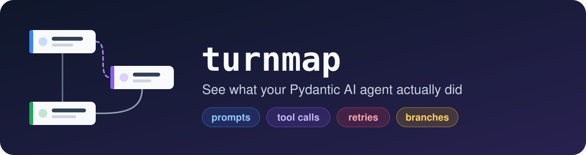
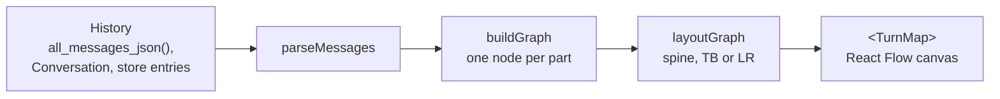

<p align="center">
  
</p>

<p align="center">
  <a href="https://github.com/rscholz98/turnmap/actions/workflows/ci.yml"></a>
  <a href="https://www.npmjs.com/package/turnmap"></a>
  <a href="LICENSE"></a>
  
  <a href="https://ai.pydantic.dev"></a>
  <a href="https://turnmap.dev"></a>
</p>

Turns a [Pydantic AI](https://ai.pydantic.dev) message history into an interactive graph: every prompt, model response, thinking block, tool call, tool return and retry as a node. It runs entirely in the browser, nothing is uploaded.

- **Website**: [turnmap.dev](https://turnmap.dev). Paste a history, drop a file or load an example.
- **React component**: `npm install turnmap`, for your own dashboard.

## How it works



## Install

```sh
npm install turnmap
```

```tsx
import { TurnMap } from "turnmap"
import "turnmap/styles.css"

export function Trace({ history }: { history: unknown }) {
  return (
    <div style={{ height: "80vh" }}>
      <TurnMap messages={history} theme="system" />
    </div>
  )
}
```

The canvas fills its parent, so give the parent a height. To switch sessions, render it with a different `messages` value.

## Input

| You have                                                        | Pass as `messages`                    | You also get                                                   |
| --------------------------------------------------------------- | ------------------------------------- | -------------------------------------------------------------- |
| `result.all_messages_json()`                                    | the array or the JSON string          |                                                                |
| a `Conversation` (`ConversationTypeAdapter.dump_json(...)`)     | the JSON as is                        | conversation id, running usage, pending deferred tool requests |
| `ConversationStore` entries (`load_entries()`, `save()`)        | the `{ id, parent_id, message }` rows | each message's entry id, and the branches among the entries    |
| a stored conversation: its `ConversationRecord` and its entries | `{ record: {...}, entries: [...] }`   | all of the above, with the record deciding the current history |
| rows from your own table                                        | `{ message: {...} }` rows             | ordered by `sequence_num` when every row has one               |

`Conversation` and `ConversationStore` are pydantic-ai's [persistence](https://pydantic.dev/docs/ai/persistence/) types, new in 2.66. Store entries are ordered by following `parent_id`, not by their position in the input. Unknown part kinds are shown as raw JSON, never dropped.

To see the branches a store kept (regenerated or edited turns), dump the record with every entry it reaches:

```python
record = await store.read_record(conversation_id)
entries = {}
for tip in [record.head_id, *record.branches]:
    for entry in await store.read_history(tip):
        entries.setdefault(entry.id, entry)

dump = {
    "record": TypeAdapter(ConversationRecord).dump_python(record, mode="json"),
    "entries": TypeAdapter(list[ConversationEntry]).dump_python(
        list(entries.values()), mode="json"
    ),
}
```

## Props

| Prop                 | Default    | Effect                                                              |
| -------------------- | ---------- | ------------------------------------------------------------------- |
| `messages`           | required   | The history, in any of the shapes above                             |
| `layout`             | `"spine"`  | `"spine"`, `"TB"` or `"LR"`                                         |
| `theme`              | `"system"` | `"light"`, `"dark"` or `"system"`                                   |
| `palette`            |            | Accent color per node family, for example `{ toolCall: "#a855f7" }` |
| `showConversation`   | `true`     | The conversation bar, drawn when the input has one                  |
| `showNavigation`     | `true`     | The first / previous / next / last control                          |
| `showMinimap`        | `true`     | The minimap in the bottom-right corner                              |
| `showControls`       | `true`     | Zoom and fit buttons                                                |
| `showBackground`     | `true`     | Dot grid                                                            |
| `fitViewPadding`     | `0.15`     | Room left around the graph when it is fitted to the view            |
| `onSelect`           |            | Called with the part node that was clicked                          |
| `className`, `style` |            | Applied to the wrapper                                              |

The stylesheet is safe to load next to your own: no CSS reset, every class prefixed with `tm:`, every color a `--tm-*` custom property on the `.turnmap` root. Dark mode follows the `theme` prop, or a `.dark` class on any ancestor.

## The graph

| Node           | Part kinds                                            |
| -------------- | ----------------------------------------------------- |
| Prompt         | `system-prompt`, `user-prompt` (attachments as chips) |
| Model response | `text`                                                |
| Thinking       | `thinking`, `compaction`                              |
| Tool call      | `tool-call`, `builtin-tool-call` (shows the provider) |
| Tool return    | `tool-return`, `builtin-tool-return` (outcome badge)  |
| Retry          | `retry-prompt` (validation errors listed)             |
| Media          | `file`, `speech`                                      |
| Note           | `tool-availability-delta`                             |
| Unknown        | anything else, as raw JSON                            |

- **Edges**: one node per part. Non-tool parts chain in order. Each tool call branches from the chain tip, so parallel calls sit side by side. A return or retry hangs off the call it answers (matched by `tool_call_id`) and becomes the tip, so the next response follows the result. A message's leaves feed the next message.
- **Groups**: each request and response is a translucent box with its model, finish reason, token usage and timestamp.
- **Layouts**: `spine` keeps prompts and responses in one column, tool calls to the right and their returns one column further. `TB` and `LR` hand the graph to dagre.
- **Side panel**: a click on a node opens its full content, metadata and raw part. Long JSON is shortened in place and opens whole in a dialog.
- **Keyboard**: the arrow keys move to the neighbouring node, Home and End jump to the ends, Enter opens the panel, Escape closes it. The viewport glides to the node (instantly with `prefers-reduced-motion`).
- **Conversations**: a bar in the corner shows the conversation id, its running usage and what a paused run is waiting on. A call named in `deferred_tool_requests` is badged `needs approval` or `awaits result` instead of `no return`. With store entries, the bar switches between the current history and each branch, and the message a branch leaves after is marked.

## Lower-level API

```ts
import { parseMessages, buildGraph, layoutGraph } from "turnmap"

const { messages, warnings, conversation, entryIds, branches } =
  parseMessages(json)
const { nodes, edges, groups } = buildGraph(messages, {
  deferredToolRequests: conversation?.deferredToolRequests,
  entryIds,
})
const laid = layoutGraph(nodes, edges, groups, { mode: "spine" })
```

`conversation`, `entryIds` and `branches` are only set for a `Conversation` or store entries. Each branch is a whole history (`branch.messages`), so you can draw it with a switch of your own. The TypeScript types of the pydantic-ai schema (`ModelMessage`, every part, `Conversation`, `ConversationEntry`, `ConversationRecord`) are exported too.

## Development

```sh
git clone https://github.com/rscholz98/turnmap && cd turnmap
npm install
npm run build:lib    # the site imports the built package
npm run dev          # the site at http://localhost:5173
npm test
```

An npm workspaces monorepo: `packages/turnmap` is the npm package, `apps/site` the website, `examples/` the example histories. Regenerate the examples with a pydantic-ai checkout, all of them or the ones named:

```sh
uv run --project ../pydantic-ai python examples/generate.py stored-conversation
```

Pushes to `main` deploy the site. To publish to npm, bump `version` in `packages/turnmap/package.json` and create a GitHub Release tagged `vX.Y.Z`.

## License

MIT
